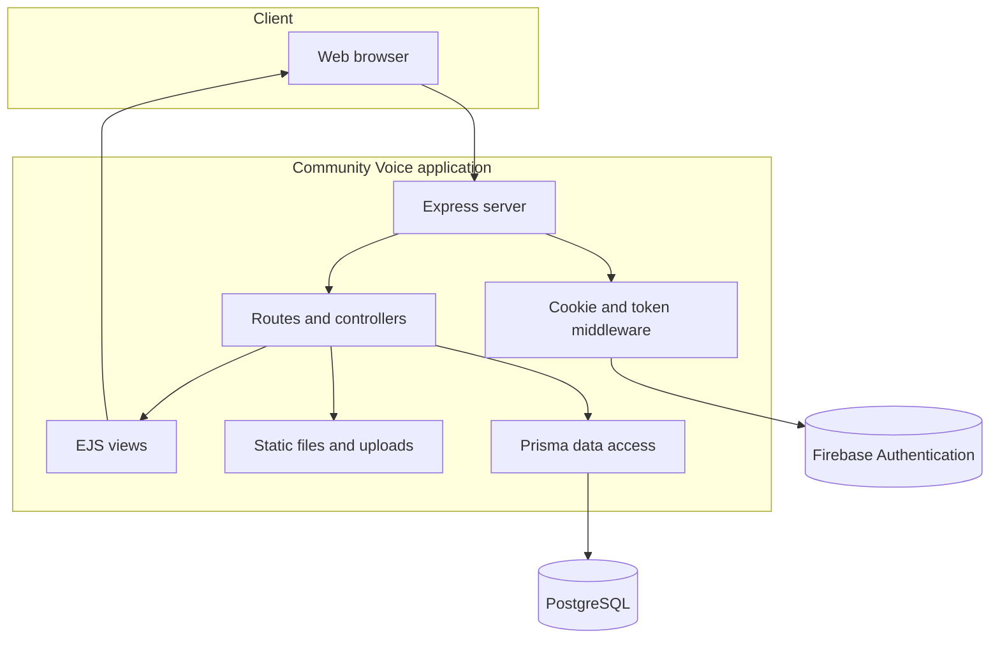

# Community Voice: Conceptual Documentation

This document is intended for developers, contributors, and assessors who need to understand how Community Voice works without reading the implementation code.

## 1. Purpose and problem

Community Voice is a civic reporting platform for Berlin. It gives residents a structured way to communicate infrastructure problems to the municipality rather than relying on informal messages or unstructured complaints.

The application turns a citizen's observation into a trackable report containing a title, description, location, optional evidence, an owner, and a status. This creates a shared record that can be followed from submission through resolution.

## 2. Users and responsibilities

### Citizen

A citizen can:

- Register and authenticate.
- Create a report about a local issue.
- Add a title, description, neighbourhood, and optional image.
- View reports and follow their progress.
- Edit or delete reports where the application permits it.

### Administrator

An administrator has elevated responsibility for managing the platform and can access administrative reporting and analytics. The data model represents administrator and citizen roles separately so that access decisions can be made based on role.

Every administrative route requires a logged-in, verified administrator, enforced by middleware. Accounts are always created as citizens; an administrator can only be made directly in the database.

## 3. System boundary

The project is a web application. The browser is the primary client. The Express server is responsible for routing, authentication middleware, validation, rendering, file handling, and coordination with external services. Firebase provides identity services, while PostgreSQL stores the application's domain data.

### Community Voice system architecture

**Figure 1: Community Voice system architecture.** Users interact with Community Voice through a web browser. Express handles requests, authentication middleware verifies Firebase tokens, routes and controllers coordinate application behaviour, Prisma provides access to PostgreSQL, EJS views generate web pages, and the upload system handles report images.

## 4. Core workflow

### Authentication

1. The user submits registration details.
2. The server checks the form, then Firebase creates the authentication identity and sends a verification email.
3. The application creates a corresponding local user profile with the citizen role, linked by Firebase ID.
4. During login, the server sends the email and password to Firebase, which returns an identity token.
5. The server exchanges the token for a Firebase session cookie, which is HttpOnly and valid for one day. Every protected request verifies the cookie and checks that it has not been revoked; logout revokes it.

### Report creation

1. The authenticated user opens the report form.
2. The user submits report details and, optionally, an image.
3. Authentication middleware verifies the session cookie and requires a verified email address.
4. The application finds the local user profile.
5. The CSRF token and the form fields are checked, and the image, if any, is recognised by its content.
6. The image is saved under a random name, and Prisma creates the report with status `OPEN`, its first status-history record, and the attachment metadata in one transaction.
7. The user is redirected to the tracking page.

### Tracking and administration

The tracking view retrieves reports from PostgreSQL 20 at a time, newest first. Administrative endpoints aggregate report data by status and identify high-volume reporters and neighbourhoods. These aggregates support monitoring and future operational decision-making.

## 5. Domain model and database design

The data model is relational:

- A **Role** can be assigned to many **Users**.
- A **City** contains many **Neighbourhoods**.
- A **User** can author many **Reports**.
- A **Neighbourhood** can contain many **Reports**.
- A **Report** can have many **Attachments** and **StatusChanges**.
- A **Report** can have many **Categories**, and a category can be applied to many reports.

The report status is restricted to `OPEN`, `IN_PROGRESS`, and `RESOLVED`. This prevents arbitrary status text from entering the database and makes reporting more consistent.

**Figure 2: Community Voice database relationships.** This entity-relationship diagram shows how users, roles, reports, locations, attachments, status changes, and categories are related in the database.

## 6. Architectural responsibilities

| Component | Responsibility |
|---|---|
| Browser and EJS views | Present forms, pages, report information, and user actions |
| Express | Receive HTTP requests and send HTML or JSON responses |
| Routes | Map URLs and HTTP methods to application behaviour |
| Middleware | Send security headers, check CSRF tokens and rate limits, verify sessions, and handle errors |
| Validation | Check every form against the rules in `src/validation/forms.js` |
| Controllers | Coordinate authentication and user-profile operations |
| Multer | Receive uploaded image files into memory, within strict limits |
| Firebase | Check passwords, and sign and verify session cookies |
| Prisma | Provide typed access to PostgreSQL models |
| PostgreSQL | Persist users, reports, locations, statuses, and attachments |

## 7. Design rationale

The project separates authentication identity from the local user profile. Firebase handles password authentication and identity verification, while PostgreSQL stores application-specific information such as names, roles, and authored reports. This allows the application to use a managed authentication service while retaining control over its domain data.

Prisma provides a central schema for relationships and constraints. Express keeps the application request-driven and lightweight, while EJS allows the server to render pages without requiring a separate frontend build system.

## 8. Implementation considerations

The security of the application, including authentication, authorisation, validation, uploads, and the development lifecycle, is described in the [security overview](security/README.md), with every threat and its status in the [threat model](security/threat-model.md).

Before deployment, verify that:

- The deployment runs Node.js 22 or later and has every environment variable from `.env.example`, with its own `CSRF_SECRET`.
- The database migrations have been applied with `npx prisma migrate deploy`.
- Uploaded files are kept on storage that survives a redeploy, or the loss of images is accepted (T-45 in the threat model).
