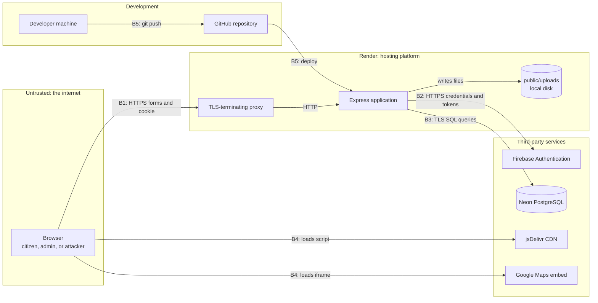

# Threat Model: Community Voice

This document records what the application must protect, who could attack it, how, and what is being done about each threat. It describes the application **as it is now**, so most threats are still marked open. The status column is updated as each fix lands.

## Contents

- [1. Scope and method](#1-scope-and-method)
- [2. System overview](#2-system-overview)
- [3. Assets](#3-assets)
- [4. Threat actors](#4-threat-actors)
- [5. Entry points](#5-entry-points)
- [6. Threats by layer](#6-threats-by-layer)
- [7. STRIDE coverage](#7-stride-coverage)
- [8. Accepted risks and shared responsibility](#8-accepted-risks-and-shared-responsibility)
- [9. Assumptions to verify](#9-assumptions-to-verify)

## 1. Scope and method

**In scope:** the Express application, its EJS views, the PostgreSQL data, the integration with Firebase Authentication, the hosting setup, and the development process.

**Method:** the system was drawn as a data-flow diagram, each trust boundary was examined with **STRIDE**, and the threats were grouped by layer.

| Letter | Threat | Property it violates |
|---|---|---|
| **S** | Spoofing | Authenticity |
| **T** | Tampering | Integrity |
| **R** | Repudiation | Non-repudiation |
| **I** | Information disclosure | Confidentiality |
| **D** | Denial of service | Availability |
| **E** | Elevation of privilege | Authorization |

**Risk rating:** likelihood and impact are each judged low, medium, or high.

| Likelihood \ Impact | Low | Medium | High |
|---|---|---|---|
| **High** | Medium | High | Critical |
| **Medium** | Low | Medium | High |
| **Low** | Low | Low | Medium |

**Status values:** *Open* means not yet addressed, *Mitigated* means fixed in the code, and *Accepted* means knowingly left in place, with the reason given in [section 8](#8-accepted-risks-and-shared-responsibility). The *Fix* column names the step of the security plan that addresses the threat.

## 2. System overview

Community Voice lets citizens report infrastructure problems to the municipality. Users register, log in, submit reports with an optional image, and track reports. Administrators can delete any report and view statistics.

Each dashed box below is a trust zone. Data crossing from one zone to another crosses a **trust boundary**, and that is where checks must happen.

| Boundary | Crossing | Main concern |
|---|---|---|
| **B1** | Browser to application | All input is untrusted. Every request must be authenticated, authorized, and validated by the server. |
| **B2** | Application to Firebase | The service-account key grants administrative control of the Firebase project. |
| **B3** | Application to database | The connection string grants access to all stored personal data. |
| **B4** | Browser to third-party content | A compromised third-party script runs with full access to the page. |
| **B5** | Developer to production | Code and dependencies reach production, so a compromise here bypasses all runtime controls. |

## 3. Assets

| ID | Asset | Where it lives | Most important property |
|---|---|---|---|
| A1 | User personal data: names, emails, phone numbers | Neon, Firebase | Confidentiality |
| A2 | User passwords | Firebase, plus bcrypt hashes in Neon | Confidentiality |
| A3 | Session tokens | `access_token` browser cookie | Confidentiality, authenticity |
| A4 | Report content and status history | Neon | Integrity |
| A5 | Uploaded images | `public/uploads` | Integrity |
| A6 | Firebase service-account key | `.env`, Render environment, `src/FirebaseService.json` locally | Confidentiality |
| A7 | Database connection string | `.env`, Render environment | Confidentiality |
| A8 | Admin role | `users.role_id` in Neon | Integrity |
| A9 | Service availability | Render, Neon, Firebase | Availability |
| A10 | Source code and dependencies | GitHub, npm | Integrity |

A1 is personal data under the GDPR, so a leak is a legal issue as well as a technical one.

## 4. Threat actors

| Actor | Access | Likely goal |
|---|---|---|
| Anonymous visitor | Any public route | Vandalise reports, harvest emails, disrupt the service |
| Registered citizen | Own account | Change or delete the reports of others, become admin |
| Automated bot | Any public route, at volume | Guess passwords, create spam accounts, fill the disk |
| Network attacker | Traffic between the user and the service | Read or alter traffic |
| Supply-chain attacker | A dependency or CDN file | Run code in the application or the browser |
| Developer, by mistake | Repository and secrets | Accidentally leak a secret, or wipe data with the seed script |

## 5. Entry points

This table shows the protection each route has **today**. It is the checklist for the authorization work.

| Route | Login required | Permission check | Notes |
|---|---|---|---|
| `GET /`, `/sign_in`, `/sign_up`, `/graph` | No | Not needed | Public pages |
| `GET /report` | No | Not needed | Form only, submission requires login |
| `GET /track` | No | Not needed | Lists every report, with no paging |
| `GET /profile` | Yes | Not needed | Shows static content |
| `POST /submit-report` | Yes | Not needed | Accepts a file upload |
| `POST /track/:id/delete` | Yes | Author or admin | The one correctly protected change |
| `GET /track/:id/edit` | **No** | **None** | See T-20 |
| `POST /track/:id/edit` | **No** | **None** | See T-20 |
| `GET /admin/report-stats` | **No** | **None** | See T-21 |
| `GET /admin/analytics` | **No** | **None** | Returns names and emails, see T-21 |
| `POST /api/upload` | **No** | **None** | See T-22 |
| `POST /api/reports` | Yes | Not needed | Cannot succeed: omits a required field |
| `GET /api/reports` | No | Not needed | Cannot succeed: selects fields that do not exist |
| `POST /api/register` | No | Not needed | No rate limit |
| `POST /api/login` | No | Not needed | No rate limit |
| `POST /api/logout` | No | Not needed | No CSRF protection |
| `POST /api/reset-password` | No | Not needed | Crashes: the function is not imported |

## 6. Threats by layer

### 6.1 Physical layer

The application runs entirely on managed cloud services, so there is no server hardware to protect. The remaining physical risk is the developer's own laptop.

| ID | Threat | STRIDE | Assets | Risk | Status | Fix |
|---|---|---|---|---|---|---|
| T-01 | Theft or loss of the developer laptop exposes `.env` and `src/FirebaseService.json` in plaintext | I | A6, A7 | Medium | Open | Disk encryption and screen lock on the machine, keys can be rotated |
| T-02 | Physical compromise or failure at a provider data centre | T, D | A1, A4, A9 | Low | Accepted | Provider responsibility |

### 6.2 Network layer

| ID | Threat | STRIDE | Assets | Risk | Status | Fix |
|---|---|---|---|---|---|---|
| T-03 | Volumetric denial-of-service attack on the public service | D | A9 | Medium | Accepted | Handled at the provider edge, see section 8 |
| T-04 | Direct connection attempts to the database from the internet using stolen or guessed credentials | S, I | A1, A7 | Medium | Open | Strong generated password, check the Neon IP allow list option |

### 6.3 Transport layer

| ID | Threat | STRIDE | Assets | Risk | Status | Fix |
|---|---|---|---|---|---|---|
| T-05 | Traffic interception between the browser and Render | I, T | A1, A2, A3 | Low | Mitigated | Render serves HTTPS. HSTS is still missing, see T-06 |
| T-06 | HTTPS downgrade, or the session cookie sent over plain HTTP, because there is no HSTS header and no `Secure` cookie flag | I, S | A3 | Medium | Open | Steps 3, 6 |
| T-07 | Traffic interception between the application and Neon | I, T | A1, A7 | Low | Mitigated | `sslmode=require` and `channel_binding=require` |
| T-08 | Traffic interception between the application and Firebase | I, T | A2, A3 | Low | Mitigated | The Firebase SDKs use HTTPS |

### 6.4 Application layer

**Authentication and sessions**

| ID | Threat | STRIDE | Assets | Risk | Status | Fix |
|---|---|---|---|---|---|---|
| T-09 | Account takeover by email: users are matched by email and `email_verified` is never checked, so registering a seeded address in Firebase gives that user's role, including admin. [`src/app.js`](../../src/app.js), [`prisma/seed.js`](../../prisma/seed.js) | S, E | A1, A4, A8 | High | Open | Step 2 |
| T-10 | One shared Firebase client on the server means simultaneous requests can act on the wrong user, and logout signs out that shared client. [`firebase-auth-controller.js`](../../src/controllers/firebase-auth-controller.js) | S, T | A3 | High | Open | Step 3 |
| T-11 | Password guessing and credential stuffing, because login has no rate limit | S | A2, A3 | High | Open | Step 6 |
| T-12 | A stolen token stays valid after logout, because logout only clears the browser cookie and nothing is revoked | S | A3 | Medium | Open | Step 3 |
| T-13 | Account enumeration and internal detail exposure through raw Firebase error messages | I | A1 | Medium | Open | Steps 3, 7 |
| T-14 | Weak passwords, because the server sets no password policy and ignores `confirm_password` | S | A2 | Medium | Open | Step 5 |
| T-15 | Password hashes are stored in Neon although Firebase handles login, so a database leak exposes more than it needs to. [`user-controller.js`](../../src/controllers/user-controller.js) | I | A2 | Medium | Open | Step 3 |
| T-16 | Spam accounts and email flooding through registration and password reset | D, S | A9 | Medium | Open | Step 6 |

**Authorization**

| ID | Threat | STRIDE | Assets | Risk | Status | Fix |
|---|---|---|---|---|---|---|
| T-20 | Any visitor can read the edit form and change any report without logging in (insecure direct object reference). [`src/app.js`](../../src/app.js) | T, E | A4 | Critical | Open | Step 2 |
| T-21 | Any visitor can call the `/admin/*` routes, and `/admin/analytics` exposes the names and emails of top reporters. [`src/app.js`](../../src/app.js) | I, E | A1 | Critical | Open | Step 2 |

**File uploads**

| ID | Threat | STRIDE | Assets | Risk | Status | Fix |
|---|---|---|---|---|---|---|
| T-22 | Stored XSS: `/api/upload` needs no login and accepts any file. An uploaded `.html` or `.svg` file is served from the application domain and runs as the victim. [`upload.js`](../../src/routes/upload.js) | T, E | A3, A4, A5 | Critical | Open | Step 4 |
| T-23 | Disk exhaustion, because uploads have no size limit | D | A9 | High | Open | Step 4 |
| T-24 | The stored file name keeps the user-supplied name, and neither type nor content is checked | T | A5 | Medium | Open | Step 4 |

**Input and output handling**

| ID | Threat | STRIDE | Assets | Risk | Status | Fix |
|---|---|---|---|---|---|---|
| T-25 | SQL injection | T, I | A1, A4 | Low | Mitigated | Prisma parameterises queries. The one raw query takes no user input, and will move to `$queryRaw` in Step 5 |
| T-26 | Stored XSS through report text | T, E | A3 | Low | Mitigated | EJS `<%= %>` escapes output, covered by a test in [`reports.test.js`](../../tests/Jest/reports.test.js) |
| T-27 | Script breakout from unescaped JSON in [`report.ejs`](../../views/report.ejs). The data comes from the seed, not from users | T | A3 | Low | Open | Step 5 |
| T-28 | Oversized or wrongly typed input, because fields are only checked for being present | T, D | A4, A9 | Medium | Open | Step 5 |
| T-29 | Slow pages and memory pressure, because `/track` loads every report with no paging | D | A9 | Medium | Open | Step 5 |

**Browser protections**

| ID | Threat | STRIDE | Assets | Risk | Status | Fix |
|---|---|---|---|---|---|---|
| T-30 | Cross-site request forgery on every state-changing form. The cookie sets no `SameSite`, and there are no CSRF tokens, so protection depends on browser defaults | T, E | A4 | High | Open | Steps 3, 6 |
| T-31 | No security headers, so there is no Content Security Policy as a second line of defence against XSS, and pages can be framed for clickjacking | T, I | A3 | High | Open | Step 6 |
| T-32 | Chart.js loads from a CDN with no integrity hash, so a compromised file would run on the page. [`graph.ejs`](../../views/graph.ejs) | T, E | A3 | Medium | Open | Step 6 |

**Errors, logging, and privacy**

| ID | Threat | STRIDE | Assets | Risk | Status | Fix |
|---|---|---|---|---|---|---|
| T-33 | Stack traces can reach users, because there is no central error handler | I | A10 | Medium | Open | Step 7 |
| T-34 | Actions cannot be traced: logins, denied access, and report edits leave no audit record, so a user can deny having made a change | R | A4 | Medium | Open | Step 7 |
| T-35 | Phone numbers are required at registration but are never used, so the application holds personal data it does not need | I | A1 | Low | Open | To be decided |

### 6.5 Development and operations

| ID | Threat | STRIDE | Assets | Risk | Status | Fix |
|---|---|---|---|---|---|---|
| T-40 | Known vulnerabilities in dependencies: `npm audit` reports 31 in production dependencies, 4 of them critical | T, E, D | A9, A10 | High | Open | Step 8 |
| T-41 | A secret is committed by mistake. None found in the history so far, but no automated check prevents it | I | A6, A7 | Medium | Open | Step 8 |
| T-42 | Unreviewed or untested code reaches production, because there is no CI and `main` is not protected | T | A10 | Medium | Open | Step 8 |
| T-43 | Service-account key misuse. It is long-lived and has broad administrative rights | S, E | A6 | Medium | Open | Rotate if ever exposed, document the procedure in Step 9 |
| T-44 | `npm run prisma:seed` deletes all data first, so running it against production destroys every report and user. [`prisma/seed.js`](../../prisma/seed.js) | T, D | A1, A4 | Medium | Open | Step 8 |
| T-45 | Uploaded files are lost on redeploy if Render storage is not persistent | D | A5 | Medium | Accepted | See section 8 |

## 7. STRIDE coverage

Every STRIDE category is represented at the application boundary (B1), and the highest risk in each category is shown here.

| Category | Worst current example | Risk |
|---|---|---|
| Spoofing | T-09 account takeover by email | High |
| Tampering | T-20 anyone can edit any report | Critical |
| Repudiation | T-34 no audit record | Medium |
| Information disclosure | T-21 emails exposed by admin routes | Critical |
| Denial of service | T-23 disk exhaustion through uploads | High |
| Elevation of privilege | T-22 stored XSS through file upload | Critical |

## 8. Accepted risks and shared responsibility

These risks are left in place on purpose, because they are the provider's responsibility or are out of proportion to this project.

| Risk | Reason |
|---|---|
| T-02 data-centre security | Physical security belongs to Render, Neon, and Google. |
| T-03 volumetric attacks | Mitigation happens at the provider edge. Application rate limits (Step 6) only cover abuse at the request level. |
| T-45 upload durability | This affects availability of images, not their confidentiality. Object storage would be the proper fix, and is beyond the Level 1 scope. |
| No multi-factor authentication | Firebase can provide it, but it adds significant work for a project of this size. |
| Dependence on third parties | The application relies on the security of Render, Neon, Firebase, and npm. Step 8 reduces this risk but cannot remove it. |

## 9. Assumptions to verify

These could not be confirmed from the repository, because they are settings in external dashboards.

- [ ] `NODE_ENV=production` is set on Render. If not, Express shows stack traces to users (T-33).
- [ ] Whether the deployed database was seeded. If so, T-09 applies to the seeded admin address unless it already has a Firebase account.
- [ ] Whether the local `.env` and the deployed service share one database. If so, local testing and seeding affect production (T-44).
- [ ] Email enumeration protection is enabled in Firebase Authentication (T-13).
- [ ] Whether Render storage for this service is persistent (T-45).
- [ ] Which IP addresses Neon accepts connections from (T-04).
- [ ] The database role used by the application has only the privileges it needs.
- [ ] The developer laptop uses disk encryption (T-01).
